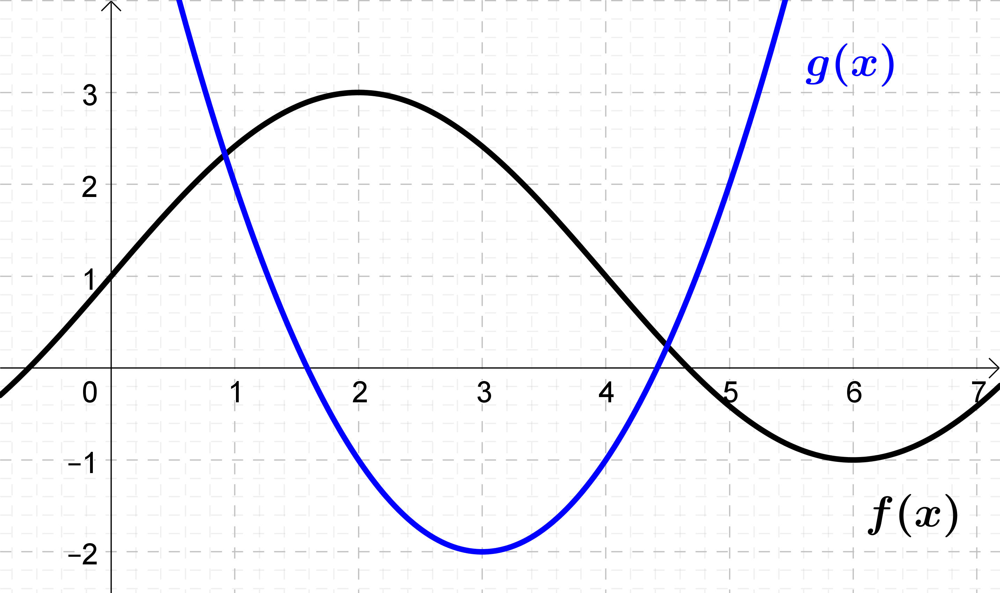

# Introduction

In [Section 3.1](unit3_1.qmd), we found that derivatives behave very simply with respect to sums and differences: the derivative of a sum is the sum of the derivatives. In this section, we investigate whether products and quotients behave as simply, and develop rules for finding the derivative of a product or quotient of two functions.

# Discussion Problems

## Problem 1 - Is the Slope of a Product the Product of the Slopes?
Let $f(x)=2x+1$ and $g(x)=3-4x$.

a. Compute $f(1)$, $f'(1)$, $g(1)$, and $g'(1)$.
b. In [Section 3.1](unit3_1.qmd), we observed that the slope of the sum (or difference) of two functions is just the sum (or difference) of their slopes. Do you think the same is true for products? That is, is the slope of the product of two functions just the product of their slopes?
c. Let $p(x)=f(x)\,g(x)$. Check whether $p'(1)=f'(1)\,g'(1)$. *(Hint: multiply out the formula for $p(x)$ first, then use the rules from Section 3.1.)* What do you conclude?

## Problem 2 - The Area of a Growing Rectangle
Consider the rectangle of height 3 cm and width 5 cm shown below:

{width=50%}

a. Suppose the height and width both increase by 0.1 cm. Approximately how much does the area increase by?
    - About 0.01 cm$^2$
    - About 0.15 cm$^2$
    - About 0.8 cm$^2$
    - About 1.5 cm$^2$
b. Let $A$ represent the area, $h$ represent the height, and $w$ represent the width of the rectangle. Suppose the height of the rectangle increases to $h+\Delta h$ and the width of the rectangle increases to $w+\Delta w$. Which of the following formulas could you use to figure out the exact amount the area increases by?
    - $\Delta A=(h+\Delta h)(w+\Delta w)$
    - $\Delta A=hw - (\Delta h)(\Delta w)$
    - $\Delta A=(\Delta h)(\Delta w)$
    - $\Delta A=h\,\Delta w + w\,\Delta h + (\Delta h)(\Delta w)$
c. Use the formula from part (b) to calculate the exact amount the area of the rectangle increases by. The estimate in part (a) was computed by ignoring part of this formula. Which part was ignored? Is it reasonable to ignore this part?
d. Now suppose the height $h(t)$ and width $w(t)$ of the rectangle are functions of time $t$ measured in seconds. Then the area is also a function of time and $A(t)=h(t)\,w(t)$. Use the product rule to write out a formula for $A'(t)$. How is this formula related to the formula you found for $\Delta A$ in part (b)?
e. Suppose that at time $t=0$:
    - The height of the rectangle is 3 cm and is increasing at a rate of 0.1 cm/sec.
    - The width of the rectangle is 5 cm and is increasing at a rate of 0.1 cm/sec.

    How fast is the area of the rectangle increasing at time $t=0$?

## Problem 3 - Practice with the Product Rule
Use the derivative rules from Sections 3.1–3.3 to compute:

a. $f'(x)$ where $f(x)=(1+x^2-3x^4)(x^7-8x^4)$
b. $g'(x)$ where $g(x)=\left(x^{3/2}-\dfrac{1}{x}\right)3^x$
c. $h'(x)$ and $h''(x)$ where $h(x)=x^4e^x$

## Problem 4 - The Quotient Rule
The quotient rule tells us how to take the derivative of a function of the form $Q(x)=\dfrac{f(x)}{g(x)}$.

a. What is the quotient rule? *(Optional: Discover the quotient rule by using the product rule to take the derivative of both sides of the equation $f(x)=Q(x)\,g(x)$ and then solve for $Q'(x)$.)*
b. Let $f(x)=\dfrac{2x-1}{2-3x}$. Find a formula for $f'(x)$.
c. Let $g(x)=\dfrac{x^2}{5+xe^x}$. Find a formula for $g'(x)$.
d. Let $h(x)=\dfrac{1}{1+x^2}$. Find a formula for $h'(x)$ and $h''(x)$.

## Problem 5 - Products and Quotients from a Graph
The graph below shows the functions $f(x)$ and $g(x)$.

{width=60%}

a. Let $P(x)=f(x)\,g(x)$. Estimate the value of $P'(4)$.
b. Let $Q(x)=\dfrac{f(x)}{g(x)}$. Estimate the value of $Q'(2)$.

## Problem 6 - Bonus Problem
The equation of the line tangent to $f(x)$ at $x=2$ is $y=3(x-2)+1$. The equation of the line tangent to $g(x)$ at $x=2$ is $y=-2(x-2)-3$.

a. Find the equation of the line tangent to $P(x)=f(x)\,g(x)$ at $x=2$.
b. Find the equation of the line tangent to $Q(x)=\dfrac{g(x)}{f(x)}$ at $x=2$.

# Justifying the Rules

:::{.callout-tip collapse="true"}
## The Product and Quotient Rules (click to expand)

:::{#thm-product-quotient}
## Product and Quotient Rules
Suppose $f(x)$ and $g(x)$ are differentiable. Then
$$
\frac{d}{dx}\left[f(x)\,g(x)\right] = f'(x)\,g(x) + f(x)\,g'(x),
$$
and, wherever $g(x)\neq 0$,
$$
\frac{d}{dx}\left[\frac{f(x)}{g(x)}\right] = \frac{f'(x)\,g(x) - f(x)\,g'(x)}{\big(g(x)\big)^2}.
$$
:::

**Product Rule.** Let $p(x)=f(x)\,g(x)$. The trick is to subtract and add the "mixed" term $f(x)\,g(x+h)$ in the numerator of the difference quotient:
$$
\begin{aligned}
\frac{p(x+h)-p(x)}{h} &= \frac{f(x+h)\,g(x+h) - f(x)\,g(x+h) + f(x)\,g(x+h) - f(x)\,g(x)}{h} \\[1ex]
&= \frac{f(x+h)-f(x)}{h}\cdot g(x+h) + f(x)\cdot\frac{g(x+h)-g(x)}{h}.
\end{aligned}
$$
As $h\to 0$, the two difference quotients approach $f'(x)$ and $g'(x)$. Also, $g(x+h)\to g(x)$, because a function that is differentiable at $x$ is also continuous at $x$ (Section 2.6). Therefore
$$
p'(x) = f'(x)\,g(x) + f(x)\,g'(x).
$$
Compare this with the rectangle in Problem 2. If we write $\Delta f = f(x+h)-f(x)$ and $\Delta g = g(x+h)-g(x)$, then $g(x+h) = g(x)+\Delta g$, and the difference quotient becomes
$$
\frac{\Delta f}{h}\,g(x) + f(x)\,\frac{\Delta g}{h} + \frac{\Delta f\,\Delta g}{h}.
$$
The last term corresponds to the small corner rectangle $(\Delta h)(\Delta w)$, and it approaches $f'(x)\cdot 0 = 0$ as $h\to 0$.

**Reciprocal Rule.** Let $r(x)=\dfrac{1}{g(x)}$, where $g(x)\neq 0$. Since $g$ is continuous at $x$, we also have $g(x+h)\neq 0$ for $h$ close enough to 0. Combining fractions,
$$
\frac{r(x+h)-r(x)}{h} = \frac{1}{h}\left(\frac{1}{g(x+h)}-\frac{1}{g(x)}\right) = -\frac{g(x+h)-g(x)}{h}\cdot\frac{1}{g(x+h)\,g(x)}.
$$
As $h\to 0$, this approaches $-g'(x)\cdot\dfrac{1}{\big(g(x)\big)^2}$, so
$$
\frac{d}{dx}\left[\frac{1}{g(x)}\right] = -\frac{g'(x)}{\big(g(x)\big)^2}.
$$

**Quotient Rule.** Write $\dfrac{f(x)}{g(x)} = f(x)\cdot\dfrac{1}{g(x)}$ and apply the product rule and the reciprocal rule:
$$
\frac{d}{dx}\left[\frac{f(x)}{g(x)}\right] = f'(x)\cdot\frac{1}{g(x)} + f(x)\cdot\left(-\frac{g'(x)}{\big(g(x)\big)^2}\right) = \frac{f'(x)\,g(x) - f(x)\,g'(x)}{\big(g(x)\big)^2}.
$$

**Returning to the Power Rule: Negative Whole Number Powers.** In the [Unit 3 Overview](unit3_index.qmd), we proved the power rule for positive whole number powers. If $n$ is a positive whole number, the reciprocal rule now gives
$$
\frac{d}{dx}\left[x^{-n}\right] = \frac{d}{dx}\left[\frac{1}{x^n}\right] = -\frac{n x^{n-1}}{\left(x^n\right)^2} = -n\,x^{n-1-2n} = -n\,x^{-n-1},
$$
which is exactly what the power rule predicts for the power $p=-n$. $\blacksquare$
:::
