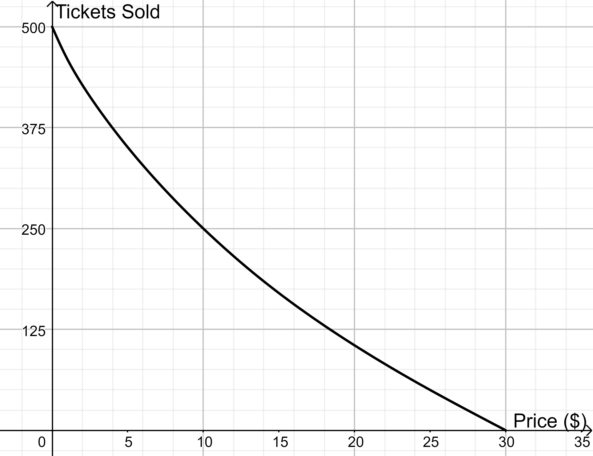
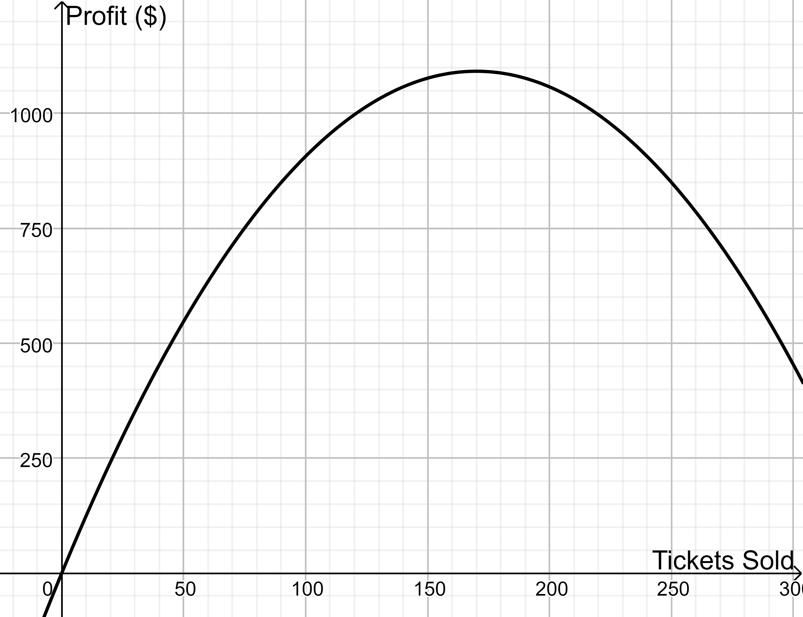

# Introduction

So far, we have rules for differentiating sums, differences, constant multiples, products, and quotients of functions. Many functions, however, are built by *composing* simpler functions, such as $e^{-x^2}$ or $\sqrt{1+x^3}$. In this section, we discover the chain rule, which tells us how to find the derivative of a composition of two functions from the derivatives of its pieces.

# Discussion Problems

## Problem 1 - Running a Marathon
Emily recently ran a marathon. During the race, she used an app that kept track of how far she had run and how many calories she had burned throughout the race. Some of this data is presented in the tables below. The first table shows how many miles she had run $t$ hours into the race. The second table shows the total number of calories she had burned after running $x$ miles.

| $t$ (hours) | 0 | 0.5 | 1 | 1.5 | 2 | 2.5 | 3 | 3.5 | 4 |
|:--|:-:|:-:|:-:|:-:|:-:|:-:|:-:|:-:|:-:|
| $x$ (miles) | 0 | 3.5 | 6.8 | 10.0 | 13.1 | 16.0 | 18.8 | 21.5 | 24.0 |

| $x$ (miles) | 0 | 3 | 6 | 9 | 12 | 15 | 18 | 21 | 24 |
|:--|:-:|:-:|:-:|:-:|:-:|:-:|:-:|:-:|:-:|
| $c$ (calories) | 310 | 610 | 700 | 970 | 1230 | 1480 | 1720 | 1950 | 2170 |

The halfway point for a marathon is 13.1 miles.

a. When did Emily reach the halfway point?
b. Approximately how fast (in miles/hour) was she running at the halfway point?
c. Approximately how many calories did Emily burn while running the first half of the race?
d. Estimate the rate at which she was burning calories (in calories/mile) at the halfway point.
e. Estimate how fast she was burning calories (in calories/minute) at the halfway point.

Let the functions $x=g(t)$ and $c=f(x)$ represent Emily's distance after running for $t$ hours and the total number of calories Emily had burned after running $x$ miles. Consider the function $h(t)=f\big(g(t)\big)$.

f. Explain what $h(2)$ represents in the context of the problem.
g. Explain what $h'(2)$ represents in the context of the problem.
h. According to the chain rule, what is the formula for computing $h'(2)$? Explain what each part of this formula represents in the context of the problem.
i. How are parts (f)–(h) related to what you did in previous parts of this problem?

## Problem 2 - Identifying the Inside and Outside Functions
Let $h(x)=3^{x^2}$.

a. Find formulas for $f(x)$ and $g(x)$ such that $h(x)=f\big(g(x)\big)$.
b. According to the chain rule, $h'(2)=f'(a)\,g'(b)$ for what values of $a$ and $b$?
c. Find the value of $h'(2)$.
d. Write out a general formula for $h'(x)$.

## Problem 3 - Practice with the Rules
Use the derivative rules from Sections 3.1–3.4 to find the derivatives of each of the following functions:

a. $f(x)=\left(x^3-3x^2+5\right)^7$
b. $g(x)=e^{1-x^2}$
c. $h(x)=x\sqrt{x^2+1}$
d. $q(x)=\left(\dfrac{x}{x+1}\right)^{1/3}$
e. $r(x)=2^{(1+3x)^4}$

## Problem 4 - Setting Ticket Prices
Let $t=g(x)$ be the number of tickets $t$ a local theater company sells for a performance when tickets are sold for $x$ dollars each. Let $p=f(t)$ be the profit that the theater company makes when they sell $t$ tickets for a performance. The graphs of these functions are shown below:

::: {layout-ncol=2}

:::

Let $h(x)=f\big(g(x)\big)$.

a. Evaluate $h(10)$ and explain what this value represents.
b. Approximate the value of $h'(10)$ and explain what this value represents.
c. The theater company currently sells their tickets for \$10 each. They are considering either lowering or increasing their ticket prices by \$0.50. Which one should they do? What would be the approximate change in profit?

# Justifying the Rules

:::{.callout-tip collapse="true"}
## The Chain Rule (click to expand)

:::{#thm-chain-rule}
## Chain Rule
If $g$ is differentiable at $x$ and $f$ is differentiable at $g(x)$, then
$$
\frac{d}{dx}\left[f\big(g(x)\big)\right] = f'\big(g(x)\big)\cdot g'(x).
$$
In Leibniz notation, if $z=f(y)$ and $y=g(x)$, then
$$
\frac{dz}{dx} = \frac{dz}{dy}\cdot\frac{dy}{dx}.
$$
:::

**Why the chain rule makes sense.** Suppose $z=f(y)$ and $y=g(x)$. A small change $\Delta x$ in $x$ produces a change $\Delta y$ in $y$, which in turn produces a change $\Delta z$ in $z$. When $\Delta y\neq 0$,
$$
\frac{\Delta z}{\Delta x} = \frac{\Delta z}{\Delta y}\cdot\frac{\Delta y}{\Delta x}.
$$
As $\Delta x\to 0$, we also have $\Delta y\to 0$ (since $g$ is continuous), so the left side approaches $\dfrac{dz}{dx}$ and the right side approaches $\dfrac{dz}{dy}\cdot\dfrac{dy}{dx}$.

This argument is not quite a complete proof: for some functions, $\Delta y$ can equal 0 for values of $\Delta x$ arbitrarily close to 0, and then we cannot divide by $\Delta y$. A fully rigorous proof handles this case separately, but the argument above captures the essential idea.

**Returning to the Power Rule: Fractional Powers.** Let $n$ be a positive whole number, let $x>0$, and let $u(x)=x^{1/n}$. Assuming $u$ is differentiable, we can differentiate both sides of the equation
$$
\big(u(x)\big)^n = x
$$
using the chain rule on the left side:
$$
n\big(u(x)\big)^{n-1}\cdot u'(x) = 1
\qquad\Longrightarrow\qquad
u'(x) = \frac{1}{n\left(x^{1/n}\right)^{n-1}} = \frac{1}{n}\,x^{\frac{1}{n}-1}.
$$
More generally, for a whole number $m$ (positive or negative), write $x^{m/n} = \left(x^{1/n}\right)^m$. Applying the chain rule together with the power rule for whole number powers,
$$
\frac{d}{dx}\left[x^{m/n}\right] = m\left(x^{1/n}\right)^{m-1}\cdot\frac{1}{n}\,x^{\frac{1}{n}-1} = \frac{m}{n}\,x^{\frac{m-1}{n}+\frac{1}{n}-1} = \frac{m}{n}\,x^{\frac{m}{n}-1},
$$
which is exactly what the power rule predicts for the power $p=m/n$. The power rule for irrational powers, such as $x^{\pi}$, can be justified once we know the derivative of $\ln x$ (Section 3.6), by writing $x^{p}=e^{p\ln x}$. $\blacksquare$
:::
