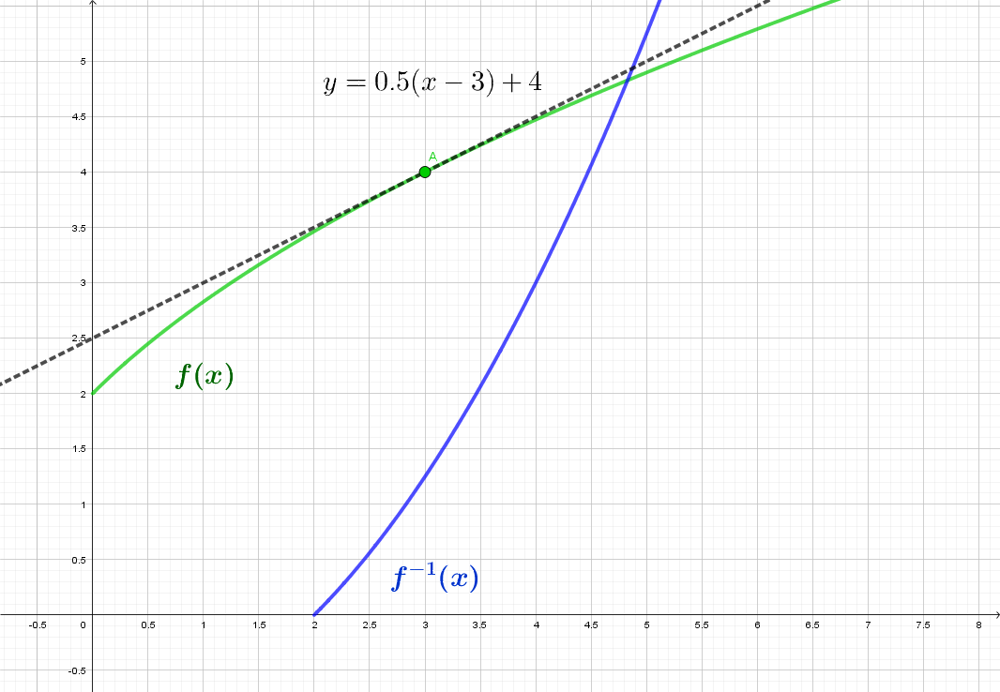
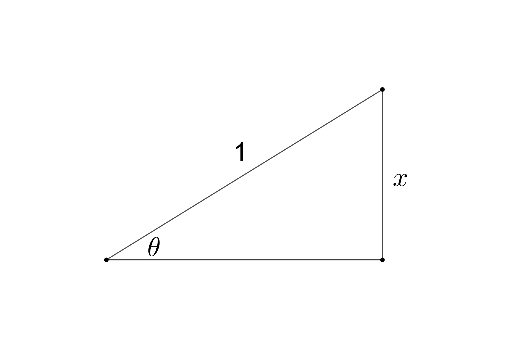

# Introduction

Many important functions are defined as the *inverse* of another function: $\ln(x)$ is the inverse of $e^x$, and $\arcsin(x)$ is the inverse of (a restricted piece of) $\sin(x)$. In this section, we use the graph of a function and its inverse, together with the chain rule, to discover a general formula for the derivative of an inverse function. We then use that formula to find the derivatives of $\ln(x)$ and the inverse trigonometric functions, and finally complete the power rule for every real power.

# Discussion Problems

## Problem 1 - Tangent Lines and Inverse Functions
The graph below shows the functions $f(x)$, $f^{-1}(x)$, and the line tangent to $f(x)$ at a certain point.

{width=70%}

Use this information to answer the following questions.

a. What is $f(3)$?
b. What is $f'(3)$?
c. Using the information given about $f(x)$, we can figure out the slope of $f^{-1}(x)$ at a certain point.
    i. At what point can we figure out the slope of $f^{-1}(x)$?
    ii. What is the slope of $f^{-1}(x)$ at this point? How do you know?
d. Write out the equation of the line tangent to $f^{-1}(x)$ at the point you found in part (c). Show that the line tangent to $f^{-1}(x)$ at this point is the inverse of the tangent line for $f(x)$ shown in the graph.

## Problem 2 - A General Formula
Recall that when we compose a function with its inverse, the rules cancel each other out. That is, for $x$ values in the range of $f$,
$$
f\big(f^{-1}(x)\big)=x.
$$

a. Take the derivative of both sides of this equation. (You will have to use the chain rule on the left-hand side.)
b. Your answer to part (a) gives you a new equation involving $(f^{-1})'(x)$. Rearrange this equation to get a general formula for $(f^{-1})'(x)$.
c. Note that if $f(x)=x^n$ for some whole number $n$, then $f$ is invertible on the interval $x\geq 0$ and on this interval, $f^{-1}(x)=x^{1/n}$. Use the general formula from part (b) for the derivative of $f^{-1}(x)$ and simplify to verify that the power rule works for roots. 
c. Note that $f(x)=e^x$ is invertible on $\mathbb R$, with $f^{-1}(x)=\ln(x)$. Use the general formula from part (b) for the derivative of $f^{-1}(x)$ and simplify to arrive at the formula for $\dfrac{d}{dx}\left[\ln(x)\right]$.

## Problem 3 - Inverse Trigonometric Functions
Recall that if $-1\leq x\leq 1$, $\theta=\arcsin(x)$ is defined as the angle $-\pi/2\leq \theta \leq \pi/2$ such that $\sin(\theta)=x$. This relationship between $\theta$ and $x$ can be represented geometrically using a right triangle.

{width=50%}

a. Let $f^{-1}(x)=\arcsin(x)$. What is $f(x)$? Use the general formula from Problem 2 to write out a formula for $\dfrac{d}{dx}\left[\arcsin(x)\right]$.
b. Simplify the formula you found in part (a) using the right triangle shown above. Your final answer should not have any trig or inverse trig functions in it.
c. You can follow a similar process to find the derivatives of $\arctan(x)$ and $\arccos(x)$. What are $\dfrac{d}{dx}\left[\arctan(x)\right]$ and $\dfrac{d}{dx}\left[\arccos(x)\right]$?

## Problem 4 - Practice with the Rules
Find the derivatives of the following functions:

a. $g(x)=x\ln(x)$
b. $f(x)=\ln(2x^4+1)$
c. $h(x)=e^{\arctan(kx)}$
d. $r(x)=\dfrac{\arcsin(x)}{\sin(x)}$

## Problem 5 - Bonus Problem
Note that a function of the form $f(x)^{g(x)}$ can be rewritten in the form
$$
\left(e^{\ln\left(f(x)\right)}\right)^{g(x)}=e^{g(x)\ln\left(f(x)\right)}.
$$
Use this observation to:

a. Prove that for any function of the form $f(x)=x^k$, where $k$ is any real number not equal to 0, $f'(x)=kx^{k-1}$.
b. Find a formula for the derivative of $f(x)=x^x$.
c. Find a formula for the derivative of $f(x)=\left(\dfrac{4}{x}\right)^x$.

# Justifying the Rules

:::{.callout-tip collapse="true"}
## Derivatives of Inverse Functions (click to expand)

:::{#thm-inverse-derivatives}
## Derivatives of Inverse Functions
If $f$ has an inverse function $f^{-1}$, then
$$
\left(f^{-1}\right)'(x) = \frac{1}{f'\big(f^{-1}(x)\big)},
$$
at every $x$ where $f^{-1}$ is differentiable and $f'\big(f^{-1}(x)\big)\neq 0$. 
:::

**General formula.** Differentiating both sides of $f\big(f^{-1}(x)\big)=x$, using the chain rule on the left side,
$$
f'\big(f^{-1}(x)\big)\cdot\left(f^{-1}\right)'(x) = 1
\qquad\Longrightarrow\qquad
\left(f^{-1}\right)'(x) = \frac{1}{f'\big(f^{-1}(x)\big)}.
$$

Note that this argument *assumes* that $f^{-1}$ is differentiable. 
Comparing the formula to what we observed in Problem 1, since the graph of $f^{-1}$ is the reflection of the graph of $f$ across the line $y=x$, a tangent line with slope $m$ reflects to a tangent line with slope $1/m$. 
So we can see that if $f$ is differentiable and $f'\neq 0$ at a given point, then $f^{-1}$ will also be differentiable at the corresponding point on its graph. $\blacksquare$

**Returning to the Power Rule: Every Real Power.** We can now finish what we started in the [Unit 3 Overview](unit3_index.qmd) and explain why the power rule works in general. For $x>0$ and any real number $k$, write $x^k = e^{k\ln(x)}$. 

By the chain rule,
$$
\frac{d}{dx}\left[x^k\right] = e^{k\ln(x)}\cdot\frac{k}{x} = x^k\cdot\frac{k}{x} = k\,x^{k-1}.
$$
So the power rule holds for every real power, including irrational powers such as $x^{\pi}$. $\blacksquare$
:::
