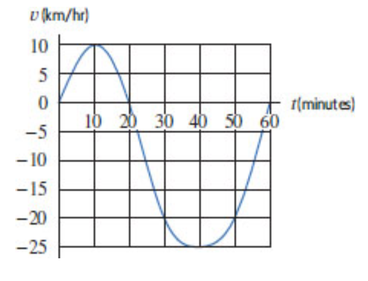

# Introduction

[At the beginning of Unit 2](unit2_index.qmd), we considered the problem of determining the velocity of an object in motion given its position $y$ as a function of time $y=f(t)$. We noted that we could try to estimate the instantaneous velocity by measuring the average velocity over small intervals of time around the given moment in time:

$$\text{Instantaneous Velocity} \approx \text{Average Velocity} = \frac{\Delta y}{\Delta t} = \frac{f(t+\Delta t)-f(t)}{\Delta t}$$

If these average velocities appeared to converge to a particular value as we made the time interval smaller, we defined this value to be our instantaneous velocity, and used the notation $f'(t)$ (or $\frac{dy}{dt}$) to represent this quantity: 

$$\text{Instantaneous Velocity} = f'(t) = \lim_{\Delta t \to 0} \frac{\Delta y}{\Delta t} = \lim_{\Delta t \to 0} \frac{f(t+\Delta t)-f(t)}{\Delta t}$$

Geometrically, if we think of the graph of the object's position versus time $y=f(t)$, we saw that this definition for measuring the object's instantaneous velocity at time $t$ is equivalent to finding the *slope* of the curve $y=f(t)$ at time $t$. 

We begin this unit with the *inverse* problem. Suppose we have the object's velocity as a function of time $\frac{dy}{dt}=f'(t)$ instead of its position. How can we use the velocity to measure the object's *displacement* over a given time interval?^[Note: Displacement measures how far the object is from its starting position. It can be either positive or negative and the sign indicates direction, like velocity.]

If we knew the object's *average* velocity over a given time interval, we could calculate its displacement exactly:

$$\text{Displacement} = \frac{\Delta y}{\Delta t} \times \Delta t = \text{Average Velocity} \times \text{Duration}$$

Given the *instantaneous* velocity, we know that on a small enough interval, the instantaneous velocity is approximately equal to the average velocity. So, on small enough intervals, we can use the instantaneous velocity to approximate displacement:

$$\text{Displacement} = \frac{\Delta y}{\Delta t} \times \Delta t \approx f'(t) \times \Delta t = \text{Instantaneous Velocity} \times \text{Duration}$$

If we want to calculate the displacement over large intervals, we break the interval up into pieces, called *subintervals*, where each piece is small enough that the instantaneous velocity doesn't change very much. This will ensure that we can use *any* value of the instantaneous velocity on each subinterval as a reasonable approximation for the average velocity on that subinterval. Then, we approximate the displacement on each subinterval and add them all up to get an estimate for the total displacement. 

# Discussion Problems

## Problem 1 - An Oil Leak

Suppose oil is leaking out of a container at a decreasing rate. The rate is measured at hourly intervals and given in the table below:

| Time (hrs) | 0 | 1 | 2 | 3 | 4 |
|:---|:---:|:---:|:---:|:---:|:---:|
| Rate (liters/hr) | 35 | 30 | 26 | 23 | 21 |

Use the table to answer the questions below.

a. During the entire 4-hour interval, what is the maximum amount of oil that could have leaked out? The minimum?
b. What is your best guess for how much oil actually leaked out during the 4-hour interval? What is the maximum possible error in your guess?

Suppose some additional data is collected about the oil leak. Now we have

| Time (hrs) | 0 | 0.5 | 1 | 1.5 | 2 | 2.5 | 3 | 3.5 | 4 |
|:---|:---:|:---:|:---:|:---:|:---:|:---:|:---:|:---:|:---:|
| Rate (liters/hr) | 35 | 33 | 30 | 27 | 26 | 24 | 23 | 22 | 21 |

c. Recalculate the upper and lower estimates in light of the new information. Make a new guess for the total amount of oil that leaked out during the 4-hour interval. Did the additional data improve your estimate? What is the maximum possible error in your estimate now?
d. If readings were taken every 0.1 hours, by how much would your upper estimate exceed your lower? What if they were taken every 0.01 hours?
e. If you had access to readings of the rate at every instant during the 4-hour interval, would you be able to calculate the total amount of oil that leaked out to any desired degree of accuracy? Why or why not?

:::{.callout-tip collapse="true"}
## Left-Hand and Right-Hand Sums (click to expand)

The estimates in Problem 1 follow a general pattern. Suppose $f(t)$ is the rate of change of some quantity for $a \le t \le b$.

1. **Divide** the interval $[a,b]$ into $n$ equal pieces, each of width $\Delta t = \dfrac{b-a}{n}$. Label the endpoints $t_0 = a,\ t_1,\ t_2,\ \ldots,\ t_n = b$.
2. **Estimate** the change on each piece by assuming the rate is constant there, using the value of $f$ at either the left or the right endpoint of the piece.
3. **Add up** the estimates:
$$
\begin{aligned}
\text{Left-hand sum} &= f(t_0)\,\Delta t + f(t_1)\,\Delta t + \cdots + f(t_{n-1})\,\Delta t = \sum_{i=0}^{n-1} f(t_i)\,\Delta t,\\[4pt]
\text{Right-hand sum} &= f(t_1)\,\Delta t + f(t_2)\,\Delta t + \cdots + f(t_{n})\,\Delta t = \sum_{i=1}^{n} f(t_i)\,\Delta t.
\end{aligned}
$$

Sums of this form are called **Riemann sums**. On the graph of $f$, each term $f(t_i)\,\Delta t$ is the area of a rectangle.

**Overestimate or underestimate?** If $f$ is *increasing* on $[a,b]$, the left-hand sum is an underestimate and the right-hand sum is an overestimate. If $f$ is *decreasing*, it is the other way around. In either case, the two sums differ by
$$
\big|\,\text{Right-hand sum} - \text{Left-hand sum}\,\big| = \big|f(b)-f(a)\big|\,\Delta t,
$$
so making $\Delta t$ smaller (taking more measurements) squeezes the two estimates together.
:::

## Problem 2 - A Bike Ride to the Lake

A bicyclist is pedaling along a straight road for one hour with a velocity $v$ shown in the graph below:

{fig-align="center" width="50%"}

She starts out 5 km from the lake. Positive velocities indicate she is going towards the lake.

a. Does the cyclist ever turn around? If so, when?
b. When is she going the fastest? How fast is she going then? Towards the lake or away?
c. When is she closest to the lake? Approximately how close is she then?
d. Estimate where she is relative to where she started at the end of the trip.
e. Estimate her total distance traveled.

:::{.callout-note collapse="true"}
## Distance vs. Displacement (click to expand)

When velocity changes sign, we have to be careful about what we are adding up.

- **Displacement** is the *net* change in position. Movement in the positive direction counts as positive, and movement in the negative direction counts as negative, so the two can cancel.
- **Total distance traveled** counts *all* movement as positive, no matter which direction it is in. It is built from the **speed** $|v|$, not the velocity $v$.

On a graph of velocity, area above the $t$-axis corresponds to movement in the positive direction, and area below the $t$-axis corresponds to movement in the negative direction.
:::

## Problem 3 - Braking Distance

The brakes are applied in a car traveling 60 mph. The car begins to decelerate at a constant rate, coming to a stop after 5 seconds.

a. Find a formula for the velocity of the car $v$, $t$ seconds after the brakes were applied.
b. Sketch a graph for the velocity of the car.
c. Using your graph, determine how far the car travels in the time between when the brakes are first applied and when it finally comes to a stop.

## Problem 4 - Running on Empty? (Revisited)

Let's return to the road trip from the Unit 5 Overview. A driver starts a 200-mile trip with a full 20-gallon tank. The graph of the rate of fuel consumption $r$, in gallons per mile, is made up of line segments, as shown below.

```{ojs}
//| echo: false
gasCorners = [
  [0, 0.040], [15, 0.050], [35, 0.050], [40, 0.060], [70, 0.055], [80, 0.045],
  [100, 0.045], [130, 0.050], [160, 0.050], [170, 0.060], [180, 0.040], [200, 0.040]
].map(([x, r]) => ({x, r}))
```

::: {style="display:flex; justify-content:center;"}

```{ojs}
//| echo: false
Plot.plot({
  width: 640,
  height: 340,
  marginLeft: 55,
  style: {background: "transparent"},
  x: {domain: [0, 200]},
  y: {domain: [0, 0.07]},
  marks: [
    Plot.gridX(d3.range(0, 201, 5), {strokeOpacity: 0.12}),
    Plot.gridY(d3.range(0, 0.0701, 0.005), {strokeOpacity: 0.12}),
    Plot.axisX({ticks: d3.range(0, 201, 20), label: "distance traveled (miles)"}),
    Plot.axisY({
      ticks: d3.range(0, 0.0701, 0.01),
      tickFormat: (d) => d.toFixed(2),
      label: "rate r (gal/mi)"
    }),
    Plot.ruleY([0], {stroke: "var(--bs-body-color)"}),
    Plot.line(gasCorners, {x: "x", y: "r", stroke: "var(--bs-body-color)", strokeWidth: 2}),
    Plot.dot(gasCorners, {x: "x", y: "r", r: 3, fill: "var(--bs-body-color)"})
  ]
})
```

:::

Calculate *exactly* how much gas is left in the tank after 200 miles.
